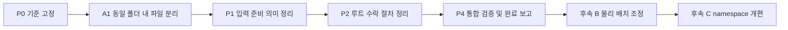
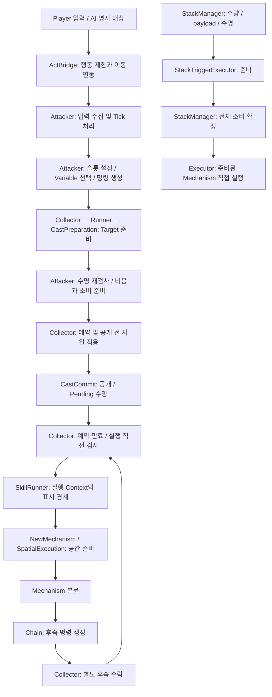

# 기술 입력·실행 파이프라인 개선 설계안

작성일: 2026-11-23 · 진행 갱신: 2026-11-24 · 개정: 2 (권장안 A 반영) · 대상: v0.2 · 상태: P4 위임 기능 검증 완료 (P3 제외)

최신 상태: 사용자 위임에 따라 실제 Input System 이벤트를 사용하는 PlayMode 기능 검증 30개를 통과했습니다. [위임 검증 보고서](SkillPipelineDelegatedValidation.md)를 참조하세요. 아래 수동 검증 대기 문구는 이전 단계 기록입니다. 화면 표현·실물 장치·원본 씬 배치 확인은 별도이며 B/C 및 Git 작업은 시작하지 않았습니다.

후속 B 진행(2026-11-24): 별도 승인 후 B0/B1 물리 이동을 완료했습니다. [B0/B1 보고서](DirectoryLayoutB0B1Report.md)와 [이동 명세](DirectoryLayoutBManifest.csv)의 B1 목적지가 현재 경로입니다. 아래 A1/P2 당시 경로·진행 상태는 역사적 기록입니다. namespace와 코드 본문은 유지했고 B2 이후 및 C는 미착수입니다.

2026-11-24 후속 결정: 사람의 실제 플레이 검증은 B/C 후 v0.2 최종 통합 시험으로 모읍니다. 각 구조 변경 단계의 컴파일·참조·직렬화·자동 회귀 검증은 그때까지 미루지 않습니다. 파이프라인의 위임 기능 검증은 완료로 유지하며, 최종 플레이 테스트가 완료됐다고 간주하지 않습니다. 사용자 요청에 따라 dev 기반 새 브랜치에 현재 파이프라인 작업을 커밋하고 B 계획서를 별도로 작성합니다. 이전 Git 미실시 표기는 각 단계 당시 기록입니다.

진행 기록: 사용자 승인에 따라 P0 기준 확인과 A1 파일 분리를 완료했습니다. 결과는 [P0/A1 작업 보고서](SkillPipelineP0A1Report.md)에 기록했습니다. 아래 설계의 후속 단계는 아직 실행하지 않았으며 Git 작업도 수행하지 않았습니다.

추가 진행: 사용자 승인 후 P1 입력 준비 훅 정리와 빈 설정 방어를 완료했습니다. [P1 작업 보고서](SkillPipelineP1Report.md)에 검증 결과를 기록했습니다. A1을 포함한 변경은 커밋하지 않았으며 P2는 미착수입니다.

최신 진행: 사용자 승인 후 P2 루트 수락 절차 정리를 완료했습니다. [P2 작업 보고서](SkillPipelineP2Report.md)에 EditMode 874개 및 PlayMode 68개 통과를 기록했습니다. 이전 진행 문단은 당시 상태이며 현재는 P4 승인을 기다립니다. Git 작업은 수행하지 않았습니다.

P4 진행: 승인 후 Stack 통합과 Travel PlayMode 검증 및 문서화를 완료했습니다. [P4 통합 보고서](SkillPipelineP4Report.md)에 자동 결과와 수동 확인 절차를 기록했습니다. 사용자는 변경 후 수동 검증 미실시를 확인했으므로 전체 완료는 보류합니다. 이전 승인 대기 문구는 각 단계 당시 기록입니다. B/C 및 Git 작업은 시작하지 않았습니다.

기준: `61cec4a6d48a174b5fbb424c45b7eee644f65d10`. 선행 조사 보고서는 작업 공간의 `audit-results/skill-pipeline-investigation-2026-11-23.md`입니다. 이 문서는 조사 결과 F1~F10을 구현 가능한 범위와 검증 기준으로 구체화합니다. 현재 코드의 정적 확인에 근거하며 새로운 테스트 실행 결과를 뜻하지 않습니다.

위 커밋은 최초 조사 기준입니다. 사용자가 Stack 작업의 원격 dev 병합을 알렸으며, 이번 문서 갱신에서는 Git 조회·동기화를 하지 않았습니다. 실제 구현 기준은 착수 시 확인하며 최초 조사 커밋으로 되돌리지 않습니다. 구조 조정 근거는 [디렉터리·namespace 조사](DirectoryNamespaceInvestigation.md)입니다. 본 개정의 범위·일정 결정이 해당 조사 당시의 선택안 및 v0.3 권고보다 우선합니다.

## 1. 제안 요약

v0.2에서는 Attacker 내부의 읽기 어려운 수락 절차와 입력 준비 명칭을 정리합니다. 계층을 합치거나 새로운 Manager를 추가하지 않습니다. 입력 수집, Target 확정, 자원 확정, 예약 실행의 시간 경계와 실패 보상 경계는 유지합니다.

이번 설계 범위는 P0~P2와 P4에 **A1 파일 분리**를 추가한 것입니다. 기존 선택 P3(생성자 공통화)는 이번 최소안에서 제외합니다. 공개 API·직렬화 형식·로그 사유는 보존합니다. 물리 이동(B)과 namespace 개편(C)은 파이프라인 개선 완료 후 진행할 **v0.2 후속 작업**으로 기록합니다. 이번 요청은 최신 설계 작성이며 구현이나 Git 작업의 착수 승인을 대신하지 않습니다.

### 1.1 확정한 작업 순서

B/C는 현재 구현 범위에 포함하지 않으며, P4 완료 후 구체 대상과 이관 계획을 검토하고 별도로 착수합니다. 각 경계를 두어 로직 변경, 경로 변경, 타입 식별 변경의 회귀 원인을 구분합니다.

### 1.2 A1 파일 분리의 정확한 범위

| 원본 | 신규 파일 | 보존할 타입 이름 / 책임 |
|---|---|---|
| `Assets/Scripts/Moves/Generals.cs` | `Assets/Scripts/Moves/SkillCommand.cs` | `Moves.SkillCommand`: 명령 데이터, 생성자, With 계열, 동등성 구현 |
| 같은 원본 | `Assets/Scripts/Moves/CastContext.cs` | `Moves.CastContext`: 실행 Context, 기존 생성자와 With 계열 |
| 같은 원본 | `Assets/Scripts/Moves/SkillUtils.cs` | `Moves.SkillUtils`: 기존 Chain 생성·전달 유틸리티 |

세 타입의 선언 전체와 관련 주석을 옮기고 필요한 using을 새 파일에 둡니다. 원본의 해당 선언만 제거하며 구현 내용·접근성·특성·필드 순서·서명·namespace는 유지합니다. 기존 파일과 폴더를 다른 위치로 이동하거나 이름을 바꾸지 않습니다. 이 세 타입은 현재 일반 C# 타입이며 MonoBehaviour/ScriptableObject 컴포넌트 분리는 포함하지 않습니다.

Generals.cs와 기존 meta는 유지하고, 새 파일에는 고유 meta를 생성·확인합니다. 기존 meta를 새 파일로 복제하거나 GUID를 재사용하지 않습니다. 새 asmdef, 새 namespace, 타입 이름 변경은 없습니다. DamageData, SwitchVariable, MechanismData, NewMechanism 및 나머지 선언은 이번 A1에서 유지합니다. Logger/ILogger 및 Interfaces.cs의 선별 분리도 이번 확정 범위에서 제외하고 후속 후보로 남깁니다.

파일 분리는 CastContext 생성자 공통화나 SkillUtils의 이름/Chain 정책 변경을 포함하지 않습니다. 따라서 A1은 기존 P3와 독립적이며, 단순 분리를 이유로 API·동작 정리를 추가하지 않습니다.

## 2. 유지할 실행 구조와 책임

| 경계 | 유지하는 이유 | 이번 변경 |
|---|---|---|
| Player/AI → ActBridge | 입력 장치 및 AI 정책과 이동·CC 정책 분리 | 기존 진입점 보존 |
| ActBridge → Attacker | 입력 수집, 슬롯 CD/Pending, 소유자 세대가 별도 상태 | Attacker 내부 절차만 분리 |
| Collector → CastPreparation | 실행 서비스 가용성과 Target 탐색을 분리 | 전달 메서드는 우선 유지 |
| Collector → CastCommit | 예약 목록과 루트 수락·종료 상태의 소유권이 다름 | 상태 전이 및 콜백 순서 보존 |
| SkillRunner → Mechanism | Context 조립/표시 실패와 실제 게임 효과 실행을 분리 | 통합하지 않음 |
| SpatialExecution | 루트·Chain·Stack이 공유하는 공간 준비 계약 | 기존 준비 완료 단락 평가 유지 |
| SwitchSelection/Variable 소비 증표 | 분기 선택과 정확한 Key 소비·보상 책임 | 기존 API 그대로 사용 |
| StackManager/Executor | 누적 상태와 직접 실행의 책임 분리 | 이번 범위에서 수정하지 않음 |

Collector의 Runner 준비 전달은 짧지만 제거 이익이 작습니다. 지금 이를 줄이기 위해 Resolver를 Attacker에 새로 주입하면 준비와 실행이 다른 Resolver를 사용하는 위험이 생깁니다. EffectDisplayer 역시 현재 구현량보다 실패 격리 경계에 의미가 있습니다.

## 3. 반드시 보존할 계약

| 항목 | 보존 조건 |
|---|---|
| 입력 시점 | release는 수집, 실제 Target 선택은 처리 Tick. performed 훅에서 Target·비용을 확정하지 않음 |
| Target | 루트 준비에서 선택 확정. 실행 때 수명/관계를 재검사하되 재탐색·사거리 재검사를 추가하지 않음. AI 명시 대상 실패는 커서 탐색으로 대체하지 않음 |
| Origin / Destination | Origin은 명시값 또는 실행 시 caster 위치. Destination은 기존 공간 설정으로 준비. CastPosition을 Origin으로 대체하지 않음 |
| DamageData | 입력 처리 Tick의 스냅샷과 Chain 상속 유지. 실행 때 Stats 재조회 금지 |
| Mana / CD | 루트 공개 전 한 번 적용. 공개 전 실패는 보상, 공개 후 취소·실행 실패는 환급하지 않음 |
| Pending | 실행 진입 또는 종료에서 한 번 해제. CD 및 이미 생성된 효과의 수명과 별개 |
| Switch / Variable | 기존 선택 순서, 정확한 Key·수량 확인, 공개 전 소비 보상, 단일 지불 증표 유지 |
| Chain | 루트 Commit 없이 후속 수락. 루트 비용 추가 금지. retarget/ExitPosition/Mask 및 지연 시작점 유지 |
| Stack Trigger | 준비 성공 → 전체 소비 → 직접 실행. 루트 Mana/CD/Pending/CanAttack 검사를 추가하지 않음 |
| 예외 | 입력별·예약 명령별 격리, 표시 실패 격리, 실행 후 무환급 유지 |
| 시간 | 이중 버퍼, 예약 기준 Tick, 세대 검사 유지. 0 Delay를 반드시 같은 Tick/다음 Tick으로 새로 고정하지 않음 |

Trigger 전체 소비 후 재진입은 새 누적 주기이며, 준비 실패 후 새 적용 요청의 재시도를 허용하는 현 계약도 유지합니다. 설정 객체는 현재 공유 참조이므로 이번 작업에서 깊은 복사나 완전한 설정 동결을 도입하지 않습니다.

## 4. Attacker 내부 설계

### 4.1 입력 준비 훅

현재 `PrepareCast`는 실제 Cast 준비가 아닌 입력 준비 알림입니다. 내부 의미를 `NotifyInputPrepared` 같은 이름으로 표현하고 기존 공개 `PrepareCast`는 호환 위임으로 남기는 안을 권장합니다. ActBridge의 공개 진입점도 유지합니다. 주석에는 Target 선택·자원 소비·Hold 시작을 수행하지 않는다고 명시합니다.

binding 존재 외에도 SkillData와 mechanismData/mechanism 유효성을 확인한 뒤 로그를 작성합니다. 없는 구성은 진단 후 반환합니다. 기존 코드에서 예외가 가능했던 경로를 안전한 반환으로 바꾸는 것이 이 단계의 의도적인 동작 변경입니다. 유효한 구성의 로그/호출 횟수는 유지하며 Hold/Charge 기능은 추가하지 않습니다.

### 4.2 TryCast는 순서를 보여 주는 조정 메서드로 유지

아래 이름은 private 메서드 후보입니다. 별도 인터페이스나 공용 프레임워크로 노출하지 않습니다.

| 후보 | 입력 / 결과 | 부작용과 제한 |
|---|---|---|
| TryValidateRootRequest | CastInput, CC 값, tick → binding 또는 사유 | 기존 순서의 수명·CD·Pending·설정 검사. 상태 변경 없음 |
| TryCaptureRootVariable | 선택한 Mechanism → SwitchVariable 또는 사유 | 기존 cases 순서와 CaptureVariable 사용. 소비 없음 |
| CreateRootCommand | input, binding, variable → SkillCommand | 일반/Switch 공통 생성 한 곳. DamageData 생성 시점 유지 |
| TryAcceptPreparedRoot | 준비된 명령, input, cost/CD, tick → 결과 | 준비 후 재검사, SwitchSelection 및 Commit 생성, Collector 호출 |

`TryCast`의 가시적인 순서는 요청 검사 → Variable 캡처 → 공통 명령 생성 → 기존 Collector Target 준비 → 준비 후 수락입니다. 초기 구현에서 검사 순서를 바꾸거나 단락 평가 조건을 합치지 않습니다. 실패 사유와 우선순위도 계약의 일부로 취급합니다.

소수의 지역 값 전달로 충분하면 구조체를 추가하지 않습니다. 인자가 실제로 과도해지는 경우에만 private 읽기 전용 묶음을 검토하며, Mechanism/Stats를 다시 캡처하거나 별도 장기 상태를 만들지 않습니다. Context.VariableStorage는 Summon 조립 순서 때문에 생성자에서 캐시하지 않습니다.

### 4.3 자원 적용과 보상은 하나의 읽기 단위

`TryAcceptPreparedRoot` 안에 기존 ApplyResources/RollbackResources 지역 함수를 함께 둡니다. 서로 다른 서비스에 나누거나 범용 Transaction 클래스로 만들지 않습니다.

1. Target 준비 후 소유자/Collector 세대를 다시 검사합니다.
2. Mana 사전 검사와 SwitchSelection 수락 가능성 확인을 수행합니다.
3. 이전 Mana, CD, 마지막 Commit Tick 및 새 예약/소비 작업을 캡처합니다.
4. Pending 해제 콜백을 가진 CastCommit을 구성하고 기존 Collector 수락 API를 호출합니다.
5. Collector가 루트 실행 예약과 비공개 명령을 확보한 후 ApplyResources를 호출합니다.
6. ApplyResources는 CD 예약 → Variable 소비 시작 → TrySpendMana → CD/Pending/마지막 Tick 기록 → 소비 Complete 순서를 보존합니다.
7. 기존 공개 경계에서 Commit을 공개한 뒤 관찰자에게 알립니다. Complete와 공개 사이에 새 사용자 콜백·실패 가능한 도메인 작업을 삽입하지 않습니다.
8. 공개 전 실패는 기존 Collector와 RollbackResources가 각자 소유한 예약·명령·소비·자원 기록을 보상합니다. 공개 후에는 이 보상을 사용하지 않습니다.

여기서 원자성은 멀티스레드 잠금이 아니라 공개 전 실패 보상과 외부 관찰 시점의 보존입니다. 기존보다 강한 모든 예외에 대한 원자성을 새로 보장한다고 주장하지 않습니다. Pending 해제는 동일 Commit인지 확인하는 현재 조건을 유지하여 새 Cast 상태를 오래된 콜백이 지우지 못하게 합니다.

### 4.4 중복 검사 처리

P2의 기본안은 검사 유지입니다. 추출만으로 책임 경계가 보이면 제거를 강행하지 않습니다. 같은 호출 구간에서 앞선 검사가 뒤의 검사를 함의하고, 사이에 콜백·가변 상태 변경·Unity 수명 변동 관찰 지점이 없으며, 실패 사유 우선순위가 동일함을 입증한 경우만 개별 삭제 후보로 제시합니다.

입력 수집→처리 Tick, Target 준비 전→후, 공개 전, 예약 dispatch의 수명 검사는 서로 다른 시점을 보호하므로 중복 제거 대상이 아닙니다. CanSpendMana 이후 TrySpendMana와 Switch CanAccept 이후 정확한 소비 재확인도 유지합니다.

## 5. 데이터 및 로그 정리의 범위

기존 선택적 P3인 CastContext 생성자 공통화는 이번 범위에서 제외합니다. A1에서 생성자와 WithSpatial/WithExit는 그대로 옮깁니다. 향후 P3를 추가하려면 공개 생성자 서명과 인자 순서가 다른 오버로드의 호환성을 보존하는 별도 변경으로 다룹니다.

CastPosition, TargetResolveResult.Anchor, SkillBinding.mode 및 respectBusy는 소비 여부/호환성 주석을 명확히 하는 대상으로 한정합니다. 필드 삭제, 직렬화 변경, respectBusy 활성화는 제외합니다. TargetRequest.CasterPos의 거리 계산용 변환은 유지합니다.

Runner와 Collector의 예외 로그 중복은 이번 필수 범위에서 제거하지 않습니다. Runner 직접 호출 경로까지 고려한 단일 기록 정책이 먼저 필요합니다. 기존 로그 이벤트명·사유 문자열을 유지하고, 새 입력 구성 오류 진단만 구분합니다. Command.Equals를 중복 제거 키로 사용하는 변경도 하지 않습니다.

## 6. 단계별 구현 및 승인 기준

| 단계 | 변경 범위 | 완료 및 회귀 기준 |
|---|---|---|
| P0 기준 고정 | 현 호출 순서·로그·공개 경계를 테스트 및 문서로 고정 | 빈/정상 슬롯, 명시 Target 실패, 준비 중 취소, 공개 전 보상과 공개 후 무환급에 대한 기존 검사 위치 확인. 필요한 행동 검사만 보강 |
| A1 파일 분리 | Generals.cs의 SkillCommand/CastContext/SkillUtils를 같은 Moves 폴더의 개별 파일로 분리 | 선언 중복 없음, 본문·타입 완전명·assembly·공개 API 동일. 기존 meta 보존/신규 GUID 고유성, 컴파일 및 관련 기존 회귀 확인 |
| P1 입력 준비 의미 정리 | Attacker 입력 준비 훅 및 호환 위임, null 구성 방어 | 빈 SkillData/Mechanism에서 예외 없음. 유효한 performed는 Target/Mana/CD/Pending 불변. release 실행 경로 유지 |
| P2 루트 수락 절차 정리 | Attacker private 추출, 공통 SkillCommand 생성, 자원 지역 함수 이동 | 일반/Switch에서 Target·Var·Damage·Mask·Trace 동일. 원래 거절 사유/순서와 보상 유지. 단계 간 수명 검사 유지 |
| P3 보류 항목 | CastContext 생성자 공통화 | 이번 실행 순서에서 제외. A1 완료에 포함하지 않음 |
| P4 통합 검증 및 문서 | 구현 범위의 관련 회귀, 수동 입력 확인, 완료 보고 | 아래 계약 표 충족, 구현된 범위와 미실시 항목 구분. 불필요한 추가 구조 변경 없이 종료 |

의존성은 **P0 → A1 → P1 → P2 → P4**입니다. A1에서는 이동 전후 타입 선언 내용을 비교하여 필요한 using 배치 외에 동작 변경이 없음을 확인하고, 기존 CastCommit/TargetContract/OriginCastPosition 등 관련 검사로 명령·Context·중첩 Chain 계약을 확인합니다. 파일 개수나 배치 자체만 확인하는 새 테스트는 추가하지 않습니다. 직렬화 애셋의 타입 이름/내용이 불필요하게 다시 저장되지 않았는지도 확인합니다.

단계별 검증이 실패하면 다음 구조 변경을 진행하지 않고 원인을 해결합니다. 각 단계 완료 시 변경·검증·미확정 사항을 보고하는 것을 기본으로 하며, 중지·대기 단위는 구현 승인에서 정합니다. Git 커밋·push 등은 별도 요청 범위를 따릅니다. P4 완료가 B/C의 자동 착수를 뜻하지 않습니다.

### 회귀 검증 표

| 보호할 동작 | 검사 후보 / 관측 |
|---|---|
| Target 선택/명시 대상/관계/Detect | CastPreparationChecks, TargetContractChecks, RelativeTargetPipelineChecks, TemporaryEnemyChecks |
| 자원 확정/보상/소비 | CastCommitChecks 및 Switch/Variable 기존 검사. Target 실패·Mana 부족·예약 실패·정확한 소비 실패 시 상태 보존 |
| 취소/파괴/비활성화/세대 | CastLifecycleChecks. Pending 한 번 해제, 공개 후 환급 없음, 오래된 입력 폐기 |
| 공간과 전달 값 | BasePositionChecks, OriginCastPositionChecks, TravelRegressionRunner. Target 고정/Origin 실행 시점/Chain Exit와 Mask 상속 |
| Tick/예약/로그 | TimeSystemChecks, AttackTraceChecks. 동일 Tick 이중 수락 방지, 예약 시작 기준, Trace 연결 및 거절 사유 |
| Stack 독립성 | StackTransitionChecks, StackBuffChecks, StackTriggerChecks, StackLifecycleChecks, StackBaselineChecks. 루트/Trigger 자원 독립 및 재진입·만료 |
| 수동 전투 | 유효/빈 슬롯 입력, Delay 중 이동·CC 취소, AI 명시 대상, Switch 소비와 후속 Chain. 기존 Stack 안내 기대 결과 유지 |

검사 클래스 이름은 기존 검사군의 연결점이며 실행 가능한 진입점/사본 절차는 착수 시 확인합니다. 메서드 추출 모양 자체를 검사하는 테스트는 추가하지 않습니다. Stack의 별도 DR 절삭 fingerprint는 파이프라인 회귀와 구분하며 정상 기대값 통과로 세지 않습니다.

사용자는 2026-11-23 기존 Stack 사용 안내의 기대 결과를 실제 관측했다고 보고했습니다. 이는 Stack 수동 검증 근거이며 아직 구현하지 않은 기술 파이프라인 변경의 통과 근거가 아닙니다. 이번 설계 작성 중 Unity 테스트를 재실행하지 않았습니다.

## 7. v0.2 후속 구조 정리와 장기 대안

### 7.1 파이프라인 완료 후 실행할 v0.2 작업

사용자 방향에 따라 B/C는 단순한 장기 보류가 아니라 **이번 파이프라인 개선 완료 후 진행할 v0.2 작업**으로 둡니다. 다만 목표 배치 전체를 한 번에 이동하는 계획은 아직 확정하지 않습니다.

| 후속 작업 | 내용과 선행 조건 | 완료 판단 |
|---|---|---|
| B 물리 배치 조정 | 디렉터리 조사 D01~D23과 목표 배치를 바탕으로 대상·순서를 확정. 타입 이름은 유지하고 기존 파일/meta를 함께 이동. 우선 Casting/Targeting, 이후 공용 Stack/Stats/Entity 등은 의존성별로 분할 검토 | 승인된 경로 대응표와 GUID 보존, Editor 경계 유지, 누락 참조 및 관련 회귀 확인. namespace 변경 혼입 없음 |
| C namespace 개편 | B 결과를 기준으로 최상위 이름과 하위 책임 경계를 확정. 직렬화 타입 및 도구 문자열의 구 이름→새 이름 매핑, 검증·복구 절차 준비 | 기존 기술/중첩 Switch·Chain의 로드·저장·재열기, 씬/프리팹 참조, Drawer/마이그레이션 도구 및 Cast/Stack 회귀 확인 |

MechanismData와 Mechanism의 SerializeReference에는 기존 namespace와 Assembly-CSharp가 저장되어 있습니다. 따라서 C는 using 치환만으로 끝내지 않습니다. TargetMaskMigration의 문자열 의존도 포함합니다. 새 assembly 분리는 C에 자동 포함하지 않으며 별도 의존성 설계 대상으로 유지합니다.

PlayGroundAssets는 이번 A1 및 파이프라인 작업에서 계속 보존합니다. 후속 C의 검증에서 해당 임시 애셋까지 필요한지와 읽기/이관 범위를 착수 전에 합의합니다. 실험 코드 삭제, Context 조립 순서 변경, Stack 정책 변경은 B/C의 부수 작업으로 수행하지 않습니다.

### 7.2 구조 변경과 별개인 장기 대안

| 대안 | 기대 효과 | 범위·위험 | 판단 |
|---|---|---|---|
| Attacker 내부 정리 | 읽기 쉬운 수락 순서, 명령 생성 중복 감소 | 국소적이지만 캡처 시점/보상 순서 회귀 주의 | v0.2 권장 |
| 별도 RootAdmissionCoordinator | 루트 수락 단위 격리·독립 테스트 | 상태와 콜백을 새 객체로 옮기며 간접 계층 증가 | 규모 증가 근거가 생긴 뒤 v0.3 |
| Collector/Runner 준비 전달 제거 | 위임 한 단계 감소 | Resolver 소유권 및 초기화 가드 이동 | v0.2 효과 작음, 보류 |
| 전투 세션별 continuation port | 주입된 루트 Collector와 전역 Chain Collector 불일치 해소 | 효과 수명, Entity 조립, Context, 세션 종료 정책 변경 | v0.3 우선 설계 후보 |
| 불변 정의와 실행 데이터 분리 | 지연 중 설정 변경 의미 명확화 | 애셋/직렬화/메모리·확장 방식 변경 | v0.3 정책 합의 후 |
| Root/Chain/Stack 통합 실행 API | 표면 진입점 감소 | 비용·Target·취소·소비 계약 변경 위험 큼 | 현재 비권장 |
| Queue 자료구조 교체 | 앞 요소 제거 비용 감소 가능 | 순서/재진입 의미 회귀, 실제 병목 미측정 | 측정 후 별도 성능 과제 |

다중 Collector 혼선은 전역 의존 구조에서 추론되는 위험이며 현재 씬에서 재현된 결함으로 단정하지 않습니다. Context 조립 순서를 고정하는 작업도 Summon의 지연 등록과 관련되므로 v0.2 내부 정리에 섞지 않습니다.

## 8. 설계 결정과 구현 승인 범위

사용자의 이번 요청으로 A를 현재 파이프라인 개선에 반영하고 B/C를 완료 후 v0.2 후속 작업으로 기록했습니다. 실제 코드 구현은 별도 착수 요청 후 진행합니다.

1. **이번 설계 범위:** P0/A1/P1/P2/P4. P3 및 Logger/Interfaces 추가 분리는 제외합니다. 이를 확대하려는 경우만 추가 결정이 필요합니다.
2. **공개 이름:** PrepareCast는 호환 위임으로 유지하고 내부 의미만 명확히 하는 기본안을 유지합니다. 공개 이름 일괄 교체는 포함하지 않습니다.
3. **진단:** 기존 로그 사유와 순서를 유지하고 중복 예외 로그 정리는 제외합니다.
4. **후속 B/C:** 목표 배치와 namespace 이름, 직렬화 이관 방법, 검증 대상은 해당 작업 착수 전에 구체화합니다. 이번 설계 갱신만으로 파일 이동·namespace 개편·Git 작업을 실행하지 않습니다.

다음은 이번 최소안의 선결 조건이 아니며, 변경할 때 별도 합의가 필요합니다: release 즉시 조준 고정, Hold/Charge, 0 Delay 실행 Tick 고정, 다중 전투 세션 지원, 지연 중 설정 동결, 표시 실패의 성공 판정, respectBusy 의미. Stack의 영구 지속시간 sentinel·비활성화 중 적용·적용자 식별 및 DR 절삭 정책도 기존 별도 과제로 유지합니다.

## 9. 코드 근거와 기존 계약 문서

- `Assets/Scripts/PlayerScripts/Acts/Attacker.cs`: TryCast의 두 명령 생성 분기, 준비 후 수명 검사, 자원 적용/보상 지역 함수, PrepareCast 구성 역참조.
- 나머지 호출 경로와 코드 위치는 선행 조사 보고서의 S1~S24 근거 색인에 연결되어 있습니다. F1~F3은 P1/P2, F5~F6의 동작 정리는 보류 P3, F7~F10은 장기/보류 항목으로 대응합니다. 파일 분리는 디렉터리 조사 D01을 A1로 반영합니다.
- [Cast Commit 계약](CastCommit.md), [Cast 준비 계약](CastPreparation.md), [Cast 회귀 검증](CastRefactorValidation.md), [Stack 안정화 기록](StackStabilization.md).

이번 작성에서는 기존 소스·애셋을 수정하지 않았습니다. PlayGroundAssets는 수정·삭제·이동하거나 Git에 강제 추가하지 않았습니다. 설계 문서는 현재 작업 커밋 이후 작성한 검토용 산출물입니다.

후속 진행(2026-11-24): B2 공용 Context·효과 수신·Stats·Stack 19개 파일의 물리 이동을 완료했습니다. namespace와 런타임 코드는 유지합니다. [B2 완료 보고서](DirectoryLayoutB2Report.md)를 참조하십시오. B3/B4 및 C는 이번 실행에 포함하지 않았습니다.

후속 진행(2026-11-24): B3 행동·이동·Entity·관계·임시 AI 20개 파일의 물리 이동과 정적 검증을 마쳤습니다. Unity는 실행하지 않았으며 import·참조 로드·회귀 검증은 대기합니다. [B3 보고서](DirectoryLayoutB3Report.md)를 참조하십시오. B4 및 C는 이번 실행에 포함하지 않았습니다.

후속 진행(2026-11-24): B4 Mechanism·효과 객체·표시·공간·진단·입력 28개 파일의 이동과 정적 검증을 마쳤습니다. [B4 보고서](DirectoryLayoutB4Report.md)를 참조하십시오. Unity와 Git은 실행하지 않았으며 B3/B4 실행 검증과 B5 통합 검증은 대기합니다.
